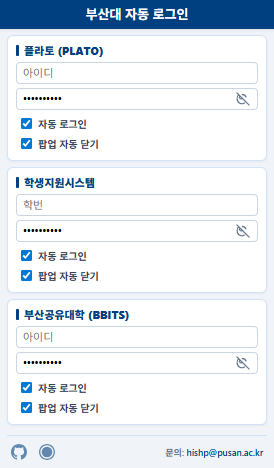
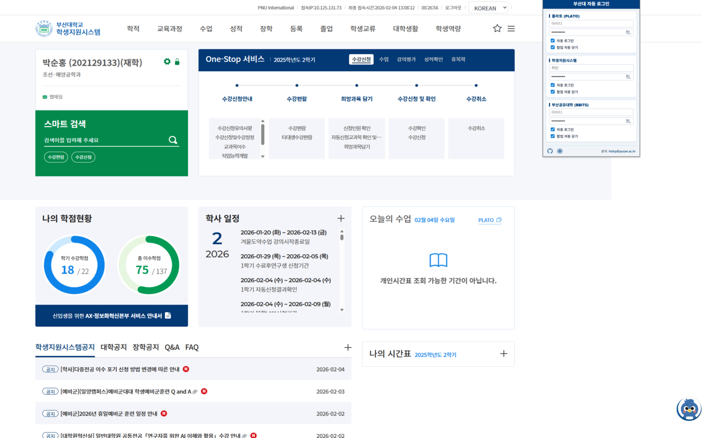

# PLATO & 학지시 & 공유대학 통합 자동 로그인 프로그램 (Chrome Extension)

부산대학교 PLATO, 학생지원시스템, 부산공유대학 이용 시 반복되는 로그인 절차를 자동화하는 크롬 확장 프로그램입니다.



---

## 1. 개발 배경
부산대학교 재학 중 겪는 실질적인 불편함을 개선하기 위해 제작되었습니다.

* **반복적인 로그인**: PLATO 및 학생지원시스템 접속 시 매번 발생하는 수동 로그인 과정.
* **공지 팝업**: 사이트 접속 시 화면을 가리는 다수의 공지사항 팝업 및 비밀번호 변경 안내 화면.
* **접속 단계 번거로움**: 부산공유대학(BBITS) 로그인 시 매번 소속 대학을 선택해야 하는 문제.

---

## 2. 업데이트 내역

* **v2026.10.17** (2026-10-16 작업):
    * PLATO와 공유대학 캘린더의 비동기 삽입이 Chrome의 재로딩 스크롤 복원과 충돌하여 화면을 아래로 미는 현상을 수정했습니다. 적용 범위는 캘린더가 삽입된 영역으로 제한합니다.
    * 같은 탭·같은 페이지의 재로딩과 탭 폐기 후 복원에서 초기 렌더링 뒤 위치를 한 번 보정합니다. 새 주소·문서 내 링크·사용자의 스크롤 입력은 우선합니다.
    * 정상 세션의 재로딩과 세션 만료 후 재로그인을 구분하는 실제 Chrome 모의 검사, 탭 폐기·freeze/resume·캐시 오류 회귀 검사를 추가했습니다. 실사이트 장시간 방치 결과는 별도 확인이 필요합니다.
    * 버전은 한국 작업 날짜에 하루를 더한 날짜로 관리합니다. 같은 날의 수정에 세부 번호를 추가하지 않으며 실제 웹스토어 게시일은 보장하지 않습니다.
* **v2026.10.14**:
    * 캘린더 과제·VOD와 강좌 퀴즈를 새 탭으로 연 뒤 로그인 페이지로 즉시 전환돼도 원래 URL을 복원하도록 수정했습니다. `noopener noreferrer`는 유지합니다.
    * 목적지와 로그인 상태를 탭별로 관리하고, 정확한 URL에 도착한 뒤 임시 의도를 정리합니다. 서비스 워커 재시작과 구버전의 진행 중 로그인 의도도 처리합니다.
    * 로그인 이동이 확정되면 홈 공지 처리를 기다리지 않도록 변경했습니다. 로그인된 홈은 문서 종료 이전에도 이동할 수 있으며 직접 누른 홈과 홈 F5 정책은 유지합니다.
    * 실제 Chrome의 새 탭·서버 리다이렉트 회귀 테스트와 익명 서버 기반 로그인 성능 비교 도구를 추가했습니다. 실사이트 인증·성능은 별도 확인이 필요합니다.
* **v2026.10.13**:
    * PLATO 홈 공지의 비동기 초기화 전에 클릭한 버튼을 처리 완료로 표시하던 오류를 수정했습니다. Splide 초기화 후 공식 버튼을 실행하고, 공지 캐러셀 제거를 확인합니다.
    * 홈 공지 표시 억제를 12초 뒤 또는 첫 공지 처리 뒤 해제하지 않도록 변경했습니다. 뒤늦게 생성된 공지와 설정 ON/OFF 전환도 처리합니다.
    * 공식 처리 실패 시 요청 간격을 늘려 재시도하며, 과제 제출·파일 선택·세션 확인창은 보호합니다.
    * 전체 검증 후 프로젝트 바로 아래의 `plato.zip`을 생성·검증하도록 배포 명령을 정리했습니다.
* **v2026.10.12**:
    * PLATO 홈 공지를 화면 표시 전부터 숨기고, 사이트의 ‘더 이상 보지 않음’ 버튼이 처리되면 임시 숨김을 해제하도록 수정했습니다. 자동 닫기 설정이 꺼져 있거나 공식 처리가 실패하면 공지를 표시합니다.
    * PLATO의 강좌·과제·강의·퀴즈·메시지·캘린더 등 모든 내부 페이지에서 ‘홈’ 메뉴를 누르면 홈에 머무르도록 수정했습니다. 홈에서 F5를 누르면 기존대로 교과과정으로 이동합니다.
    * PLATO 캘린더의 강좌 상태와 월간 일정을 먼저 갱신하고, 상세 페이지의 정확한 마감 시각은 이후 보강하도록 변경했습니다. 짧은 간격의 중복 상세 조회를 줄이고, 느린 상세 요청이 다른 요청을 막지 않도록 했습니다.
    * PLATO와 부산공유대학에서 보조 스크립트 로딩이 어긋나도 월간 날짜가 사라지지 않도록 복구했습니다.
    * 손상된 날짜 캐시와 일정 수집 실패 시에도 기본 날짜를 유지하고, 좁은 화면에서 일정 건수 배지가 잘리지 않도록 조정했습니다.
    * 실제 Chrome에 확장 프로그램을 설치해 두 캘린더와 기존 기능을 검사하는 릴리스 검증 명령을 추가했습니다.
    * PLATO 자동 재로그인 후 클릭한 활동이나 직접 요청한 페이지로 돌아가도록 수정했습니다. 목적지가 없는 첫 로그인은 교과과정으로 이동합니다.
    * PLATO 홈 공지에서 확인된 ‘더 이상 보지 않음’ 버튼을 사이트의 공식 동작으로 처리하고, 과제·파일 선택 등 작업 대화상자가 자동으로 닫히지 않도록 범위를 제한했습니다.
    * 교과과정에서 직접 누른 ‘홈’ 이동과 홈 새로고침 동작을 유지했습니다.
    * PLATO 활동 상세 페이지와 부산공유대학 강좌·과제 화면의 마감 시각을 분·초 정밀도에 맞춰 캘린더 카드에 표시합니다. 시각이 없는 일정은 이를 명시합니다.
    * 실제 마감 시각으로 기한 경과를 판단하고, 완료 일정의 중복 D-Day 배지를 제거했습니다.
    * 익명화한 팝업·과제·캘린더 재현 페이지와 자동 테스트를 추가했습니다.
* **v2026.10.11**:
    * 배포 파일의 구성, 버전, JavaScript 구문 및 리소스 참조를 검사하는 릴리스 도구를 추가했습니다.
    * Chrome 웹스토어 제출용 ZIP을 버전별로 생성하고, ZIP 내부 파일이 현재 소스와 일치하는지 검증합니다.
    * 자동 로그인과 캘린더의 동작은 변경하지 않았습니다.
* **v2026.09.14**:
    * 달력 일자별 일정 표시 시 아직 미완료된 일정(빨간색)이 최우선으로 정렬되어 먼저 표시되도록 우선순위 개선 (전체 3개 이하 일정은 모두 직접 노출).
    * 캘린더 월 이동 시 기존 캐시를 즉시 표시한 뒤 백그라운드에서 최신 일정을 재검증하여 다른 월 과제 갱신 누락 방지.
    * 1학기 3월부터 6월, 2학기 9월부터 12월 등 같은 학기에 해당하는 전체 월 백그라운드 일괄 자동 동기화 지원.
    * 수동 새로고침 시 전체 강좌 상태 맵 및 캐시 타임스탬프 완전 초기화 적용.
    * 플라토 및 부산공유대학 캘린더 일괄 적용.
* **v2026.09.07**:
    * 부산공유대학 LMS(`lms.bbits.ac.kr`) 캘린더 위젯 추가 (VOD 진도율 및 과제 제출 여부 실시간 추적).
    * 강의 일정을 시작일이 아닌 실제 마감일(Due Date) 기준으로 배치.
    * 플라토 및 공유대학 캘린더의 지난 날짜를 완료 여부와 무관하게 회색으로 통일.
    * 교과과정 페이지에서 '홈' 버튼 클릭 시 1회성 홈 화면 유지 (홈에서 새로고침 시 교과과정으로 자동 이동).
    * 캘린더 갱신 중 기존 데이터 유지 및 상단 프로그레스 바 표시.
    * 강좌명 접두사 정리 및 캘린더 최대 너비(1200px) 설정.
    * 설정 팝업에 '공유대학 캘린더 표시' 항목 추가 및 체크박스 순서 통일.
    * 플라토 개발/테스트 서버(`dev-plato.pusan.ac.kr`, `dev-plato.ac.kr`) 자동 로그인 지원.
* **v2026.09.04**:
    * 2026년도 플라토 UI 개편에 맞춘 로그인 로직 대응.
    * 플라토 교과과정 페이지 학업 캘린더 대시보드 위젯 추가.
    * 세션 만료 감지 및 자동 재로그인 (작업 중이던 URL 보존).
    * Bootstrap 5 공지 팝업 자동 닫기 대응.
    * 부산공유대학 자동 로그인 및 소속 대학 자동 선택 지원.
* **이전 버전**:
    * Manifest V3 전환 및 `chrome.storage.local` 적용.
    * 학생지원시스템 비밀번호 변경 안내 화면 자동 통과.
    * 플라토 및 학생지원시스템 자동 로그인 및 팝업 닫기 구현.

---

## 3. 주요 기능



### A. 자동 로그인
* **플라토 (PLATO)**: `plato.pusan.ac.kr` 및 개발 서버(`dev-plato.pusan.ac.kr`, `dev-plato.ac.kr`), 세션 만료 페이지(`/login.php?errorcode=4`)에서 저장된 계정으로 자동 로그인합니다.
* **학생지원시스템**: SSO 연동을 통해 접속 시 자동으로 세션을 연결합니다.
* **부산공유대학 (BBITS)**: 포털 및 LMS 로그인 시 소속 대학('부산대학교')을 자동 선택하고 로그인합니다.
* **세션 만료 재로그인**: PLATO에서 클릭한 링크와 직접 입력한 활동 URL을 탭별로 보존하고, 이용 중 만료된 경우 원래 페이지로 돌아갑니다. 새 탭의 HTML 표시 전 로그인 리다이렉트도 처리하며 경로·쿼리·fragment를 유지합니다. 목적지가 없는 최초 로그인은 정규 교과과정으로 이동합니다. 개발 서버의 기존 URL 복원 동작은 유지합니다. 페이지의 미저장 입력 내용은 사이트 자체 복구 기능에 따릅니다.

### B. 플라토 학업 캘린더
* **교과과정 페이지 캘린더**: 로그인 후 정규 교과과정 페이지(`allcourse/regular/index.php`) 상단에 월간 캘린더를 표시합니다.
* **일정 수집 및 상태 표시**: 수강 강좌의 과제 마감일과 VOD 강의 출석 인정 기간을 표시합니다.
    * 완료: 녹색, 미완료: 적색, 지난 일정: 회색으로 구분합니다.
    * 날짜 우측 상단에 마감 일정 건수 뱃지를 표시합니다.
* **캐시 렌더링 및 자동 갱신**: 마지막 일정 데이터를 즉시 표시하고, 교과과정 페이지 진입 시 최신 강좌 상태와 월간 일정을 먼저 갱신한 다음 정확한 마감 시각을 보강합니다.
* **갱신 중 기존 데이터 유지**: 새로고침 중에도 기존 일정을 유지하며 상단 프로그레스 바로 진행 상태를 표시합니다.
* **상세 활동 패널**: 날짜를 클릭하면 강좌명, 과제/강의명, 확인된 마감 시각, 미완료 일정의 D-Day와 바로가기 링크를 표시합니다. 원본에 초가 있으면 초까지 표시하며, 시각 정보가 없으면 ‘마감 시각 확인 불가’로 안내합니다.
* **월간 이동 및 접기/펼치기**: 이전/다음 달 이동 및 현재 월 복귀를 지원하며, 상단 토글 바로 캘린더를 접거나 펼칠 수 있습니다 (접힘 상태 저장).
* **홈 화면 이동 제어**: PLATO의 어느 내부 페이지에서든 '홈' 메뉴를 클릭했을 때는 홈 화면을 유지하고, 홈에서 새로고침(F5)을 하거나 다른 경로로 접근하면 교과과정 페이지로 이동합니다.

### C. 부산공유대학 캘린더
* **메인 대시보드 캘린더**: 부산공유대학 LMS(`lms.bbits.ac.kr`) 메인 화면 강좌 목록 상단에 월간 캘린더를 표시합니다.
* **진도율 및 과제 추적**: VOD 강의 진도율(100%) 및 과제 제출 여부를 확인하여 마감일에 일정을 배치합니다.
* **플라토 동일 기능 지원**: 캐시 렌더링, 갱신 중 화면 유지, 상세 활동 패널, 월간 이동, 접기/펼치기 토글을 지원합니다.

### D. 팝업 및 안내 화면 자동 닫기
* **PLATO 홈 공지 처리**: 설정이 켜져 있으면 홈 방문 동안 확인된 공지를 숨기고, 사이트 초기화 후 ‘더 이상 보지 않음’ 버튼을 누릅니다. 공식 처리 실패 시 간격을 늘려 재시도합니다. 설정을 끄거나 설정 조회·처리 스크립트 로딩에 실패하면 표시 억제를 해제합니다. 과제 제출, 파일 선택, 확인·경고 대화상자는 처리하지 않습니다.
* **비밀번호 변경 안내 통과**: 학생지원시스템 접속 시 나타나는 비밀번호 변경 안내 화면을 자동으로 통과합니다.

### E. 설정
* 설정 팝업에서 사이트별 자동 로그인, 팝업 자동 닫기, 캘린더 표시 기능을 개별적으로 ON/OFF 할 수 있습니다.

---

## 4. 데이터 보안
* 모든 계정 정보는 브라우저 내부 로컬 저장소(`chrome.storage.local`)에만 저장됩니다.
* 로그인 시 계정 정보는 각 서비스의 로그인 페이지로 전달됩니다. 확장 프로그램 개발자의 별도 서버로 전송하는 코드는 없습니다.

---

## 5. 개발자 정보 및 지원
* **이메일**: hishp@pusan.ac.kr
* **GitHub**: [https://github.com/hi-shp/plato_auto_login](https://github.com/hi-shp/plato_auto_login)
* **웹스토어**: [PLATO 자동 로그인 설치 페이지](https://chromewebstore.google.com/detail/plato-%EC%9E%90%EB%8F%99-%EB%A1%9C%EA%B7%B8%EC%9D%B8/alfanhjkmennhlhicpinigkgkifknamm)

---

## 6. 개발 및 배포

프로젝트 구조와 저장 키는 [PROJECT_STRUCTURE.md](./PROJECT_STRUCTURE.md)를 참고하세요. Python 3와 Node.js가 필요하며, 릴리스 도구에는 별도의 Python 패키지가 필요하지 않습니다. 전체 브라우저 검증에는 Chrome과 Selenium이 필요합니다.

```powershell
python -m pip install -r requirements-test.txt
python scripts/verify.py
# 한국 작업 날짜 + 1일을 manifest와 README 버전에 사용합니다. 같은 날의 수정은 같은 버전을 사용합니다.
python scripts/verify.py --package
python scripts/release.py --verify
```

`python scripts/verify.py`는 정적 검사, 단위 테스트, 두 사이트의 격리된 Chrome 확장 프로그램 E2E, Git 공백 검사를 집계합니다. `--package`는 테스트 통과 후 프로젝트 루트의 `plato.zip`을 만들고 검증합니다. `python scripts/release.py`를 직접 실행해도 같은 회귀 검사를 먼저 실행합니다. manifest 버전은 한국 작업 날짜에 하루를 더한 `YYYY.MM.DD`를 사용합니다(2026-10-16 작업 → `2026.10.17`). 같은 날 여러 번 수정해도 네 번째 숫자를 추가하지 않으며, Git 커밋으로 변경 이력을 관리합니다. 이 날짜는 게시 예정일을 나타내는 프로젝트 규칙이며 실제 웹스토어 심사·게시일을 보장하지 않습니다. 기존 ZIP이 현재 소스와 다르면 새 ZIP을 먼저 검증한 뒤 기존 ZIP을 안전하게 교체합니다. 웹스토어가 현재 게시 버전보다 낮거나 같은 버전의 업로드를 거부할 수 있으므로, 로컬 ZIP 생성과 웹스토어 게시 가능 여부는 별도로 확인해야 합니다.

`node scripts/benchmark_refresh.js`는 익명화한 12개 일정과 고정된 모의 응답 지연으로 2026.10.11, 이번 수정 전, 현재 소스의 첫 렌더링 및 최종 완료 시간을 비교합니다. 실제 PLATO 서버의 속도를 측정한 결과는 아닙니다.

`python scripts/benchmark_login.py --rounds 3`은 이전 로그인 코드와 현재 소스를 실제 격리 Chrome에서 비교합니다. 새 Chrome·기존 Chrome, 모의 세션 정상·만료와 공지 ON/OFF·유무를 나누고 단계별 시간·중앙값·P95를 기록합니다. 결과와 한계는 [LOGIN_PERFORMANCE.md](./LOGIN_PERFORMANCE.md)에 정리합니다. 실제 LMS 성능 수치가 아니며 홈 화면 노출이 항상 완전히 제거되는 것은 아닙니다.

새 탭의 서버 리다이렉트를 포착하기 위해 `webNavigation` 권한을 사용합니다. `storage.session`의 탭별 목적지는 브라우저 메모리에만 저장되며 로그인 경로·외부 주소·인증정보가 포함된 URL은 제외합니다. 계정 설정과 캘린더 캐시의 기존 저장 키는 유지합니다.

ZIP에는 확장 프로그램이 참조하는 실행 파일만 들어갑니다. `plato.zip`, `dist/`와 에이전트 지침 파일은 Git에서 제외됩니다. 검증 후 변경 파일을 검토하여 커밋하고 `origin/main`에 푸시합니다. 웹스토어 업로드와 게시, 실제 로그인 확인은 별도 수동 작업입니다.

로컬 재현 페이지 `tests/fixtures/popup-lab.html`은 공지·중첩 모달·지연 팝업을 반복 생성하고 Reset할 수 있습니다. `assignment-flow.html`은 파일 선택부터 최종 제출 및 캘린더 완료 표시까지 모의합니다. 실제 환경 확인 범위와 테스트 한계는 [TESTING.md](./TESTING.md)에 기록했습니다.
